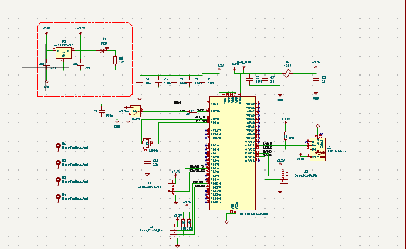
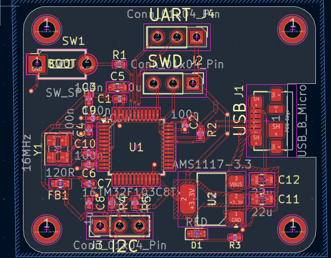
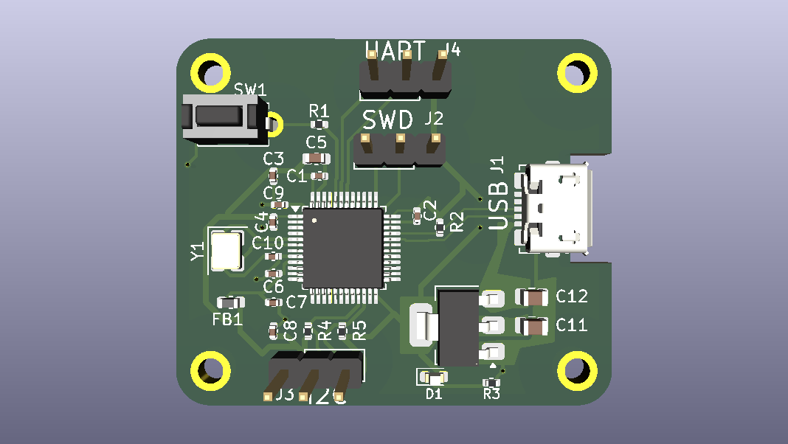

# STM32 Microcontroller Development Board | KiCad 6

## Project Overview

Designed a custom STM32 ARM Cortex-M microcontroller development board using KiCad 6, covering schematic capture, component selection, circuit design and two-layer PCB layout.

The project focuses on developing a compact embedded development platform with essential microcontroller support circuitry, power management, clock generation, USB connectivity and debugging interfaces.

## Design Features

- Custom STM32 ARM Cortex-M development board.
- Two-layer PCB design.
- Power regulation and decoupling circuitry.
- External crystal clock circuitry.
- USB connectivity.
- SWD programming and debugging interface.
- Boot and reset control circuitry.
- Analog supply filtering.
- Component placement, routing and PCB design rule checks.

## Schematic Design

The schematic includes the microcontroller, power supply, clock generation, USB interface, debugging connections and supporting circuitry.

## PCB Layout and Routing

Designed a two-layer PCB with component placement, signal routing, power distribution and grounding considerations.

## 3D PCB Visualization

The final PCB design was visualized using the KiCad 3D Viewer to inspect component placement and overall board arrangement.

## Hardware Design Considerations

- Component selection and footprint assignment.
- Power regulation and decoupling.
- Signal routing and track management.
- Grounding and power distribution.
- Board outline and mounting holes.
- Design Rule Check (DRC).

## Tools and Technologies

| Category | Tools |
|---|---|
| PCB Design | KiCad 6 |
| Schematic Capture | KiCad Schematic Editor |
| PCB Layout | KiCad PCB Editor |
| 3D Visualization | KiCad 3D Viewer |
| Microcontroller | STM32 ARM Cortex-M |

## Repository Contents

| File | Description |
|---|---|
| `stmdemo.kicad_sch` | KiCad schematic source |
| `stmdemo.kicad_pcb` | PCB layout source |
| `stm32_sch.png` | Schematic visualization |
| `stm32_layout.png` | PCB layout and routing |
| `stmdemo.png` | 3D PCB render |
| `report.txt` | Design report |

## Project Objectives

- Gain practical experience in PCB design and schematic capture.
- Understand microcontroller hardware interfacing.
- Implement essential power and debugging circuits.
- Develop skills in component placement and PCB routing.
- Apply hardware design rules using KiCad.

## Author

**Rushan S**

Electrical and Electronics Engineering

GitHub: [Rushan-S](https://github.com/Rushan-S)

---

*Designed using KiCad 6.*
